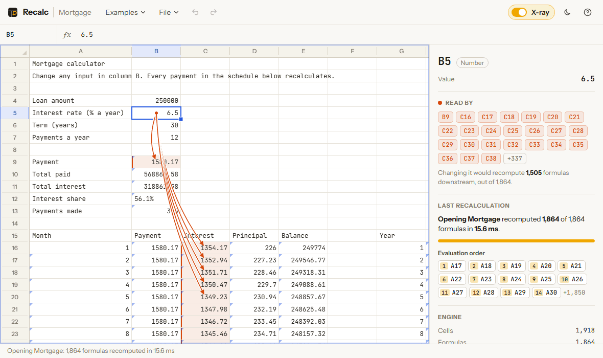
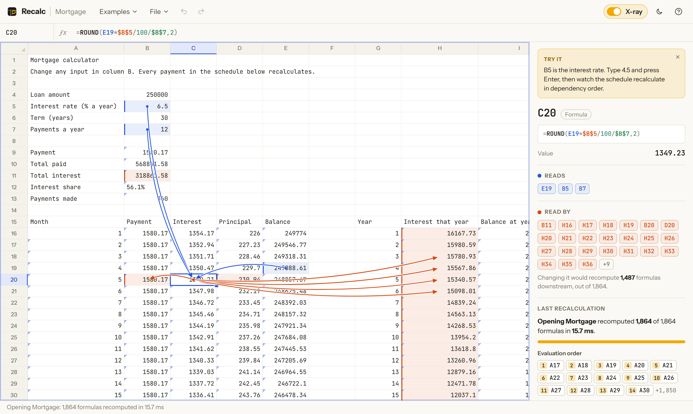
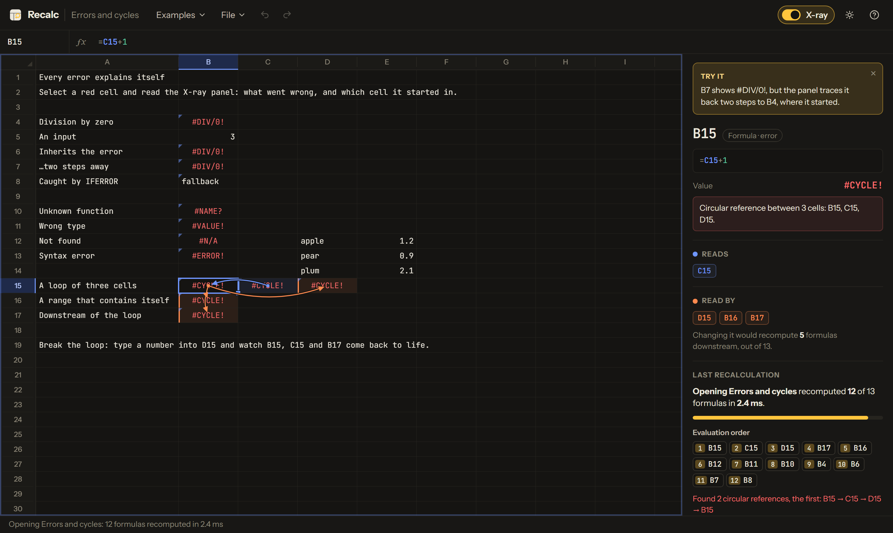
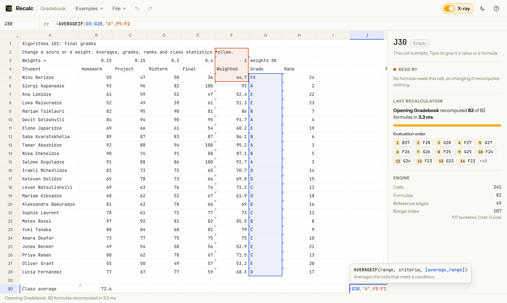

<div align="center">

# Recalc

**A spreadsheet engine written from scratch, with an X-ray that shows it working.**

Formula parser, dependency graph, incremental recalculation and a million-row grid, in TypeScript and React, with no spreadsheet libraries.

### [Try it live →](https://recalcbyluka.netlify.app/)

[](https://github.com/LukaLomadze1/recalc/actions/workflows/ci.yml)



</div>

## What this is

Change one cell in a spreadsheet and every formula that depends on it, directly or through other formulas, has to be
recomputed in the right order, while everything else is left alone. Recalc does that with its own parser, its own
dependency graph and its own scheduler, and then shows you what it did.

Turn on **X-ray** and select a cell: blue arrows point from what it reads, orange arrows to what reads it. Edit a value
and the cells that were recomputed light up one after another, in the exact order the engine evaluated them. The panel
on the right says how many formulas ran, how many were skipped, and why any error is an error.

- **98 functions**: `VLOOKUP`, `XLOOKUP`, `INDEX`/`MATCH`, `SUMIFS`, `COUNTIFS`, `IFERROR`, `TEXT`, `PMT`, `IRR` and more.
- **Excel's grid size**: 1,048,576 rows by 16,384 columns, drawn on a canvas.
- **Excel's behaviour where people rely on it**: copied formulas shift their references, `$A$1` stays put, inserting a row
  rewrites every formula on the sheet, the fill handle continues series, `=-2^2` is `4`.
- **Errors explain themselves**: `#DIV/0!` in B7 tells you it started in B4 and came through B6. Circular references are
  detected, named, and recover the moment you break the loop.
- **No server**: sheets are saved in your browser, and a share link carries the whole sheet inside the link.

## Measured

| What | Formulas recomputed | Time |
|---|---:|---:|
| Mortgage: open and compute everything | 1,864 of 1,864 | 14 ms |
| Mortgage: change the interest rate | 1,505 of 1,864 | 2.7 ms |
| Mortgage: change a label | 0 of 1,864 | 14 µs |
| Stress test: open 300,000 cells | 200,005 of 200,005 | 753 ms |
| Stress test: change the top of a 100,000-deep chain | 100,006 of 200,005 | 145 ms |
| Stress test: change a cell near the bottom | 8 of 200,005 | 35 ms |
| Stress test: change an unrelated cell | 0 of 200,005 | 48 µs |

The parser handles about **515,000 formulas a second**. Measured with `npm run bench` on an Intel Core i5-12400F, Node 24,
median of seven runs ([raw numbers](docs/bench.json)). The 35 ms row recomputes only 8 formulas, but four of them are
`SUM`, `AVERAGE`, `COUNTIF` and `VLOOKUP` over whole columns of 100,000 values.

## The headline: how do you know incremental recalculation is right?

Recomputing only part of a sheet is faster than recomputing all of it. The risk is skipping a formula that should have
run, which leaves a stale number on screen that looks perfectly normal. So the engine is checked against a second one.

`src/engine/naive.ts` is a deliberately simple reference evaluator: no dependency graph, no index, nothing incremental.
It recomputes the whole sheet from the raw text, expands every range into concrete cells, and finds cycles by asking
each cell "can you reach yourself?". The fuzzer generates random sheets (formulas with refs, ranges, whole columns,
lookups, `SUMIF`, cycles, parse errors), applies random edits, pastes, and row and column inserts and deletes, and
after **every** edit compares every value in the two engines.

**30,000 random edits run in the unit tests, and 150,000 more in CI.** They have to agree on every cell, every time.

### A fuzzer that has never failed has proven nothing

So the engine has five deliberate bugs that can be switched on (`src/engine/sheet.ts`, `Bug`), and a test that the
fuzzer finds each one:

| Planted bug | What goes wrong | Caught on seed |
|---|---|---:|
| `ignore-ranges` | Edits inside a range never reach `=SUM(A1:A10)` | 1 |
| `wrong-order` | Formulas evaluated before the formulas they read | 1 |
| `self-loop` | `=A1+1` in A1 is not reported as a cycle | 1 |
| `lowlink` | Tarjan's algorithm splits a cycle into pieces | 1 |
| `first-bucket-only` | The range index forgets everything past row 256 | 3 |

The last row is the interesting one. The fuzzer places cells on hand-picked coordinates (rows 255 and 256, row 20,000,
column BS) instead of a neat block. **With a dense 6×4 block instead, 2,000 seeds never catch `first-bucket-only`**,
because every cell sits in the first bucket. You can check: `npm run fuzz -- --bug first-bucket-only`.

### What it found in my own code

The fuzzer caught a real bug on its 13th seed, before any of the planted ones existed. `SUMIF(B2:C257, "", A3:C3)`
does not sum `A3:C3`. Excel stretches the sum range to the shape of the criteria range, so it really reads `A3:B258`.
My dependency graph recorded the range as written, so when A256 changed, the `SUMIF` kept a stale value. The naive
evaluator, which only follows what the function actually reads, disagreed. The fix records the resized range
(`resizedSumRange` in `src/engine/parser.ts`).

## See it

### What reads what



### Every error traced to where it started



### Writing formulas

Colour-coded references that outline their ranges on the grid, function suggestions, and the signature of the function
you are in, with the current argument highlighted. While typing a formula, click or drag on the grid to insert a reference.



## How it works

**Parsing.** A hand-written lexer and a Pratt parser (`src/engine/lexer.ts`, `parser.ts`) produce a small AST. Excel's
grammar has traps that a textbook expression parser gets wrong: unary minus binds tighter than `^` (`=-2^2` is 4), `^`
is left-associative (`=2^3^2` is 64), and `LOG10` is a cell reference unless it is followed by `(`. Every token keeps its
position, which the formula bar uses for colouring and the copy code uses to rewrite references without touching
anything else the user typed.

**The dependency graph.** Single references are stored as reverse edges: A1 → the formulas that read A1. Ranges cannot
be stored that way. `=SUM($A$1:A5000)` in each of 5,000 rows would mean 12.5 million edges. Instead, each range is
stored once in a range index (`rangeIndex.ts`) in one of three shapes: small ranges in 256-row × 1-column buckets, tall
ranges (like `A:A`) in a list per column, and very wide ranges in a single list. Asking "which formulas read B300?" looks
at one bucket, one column list and the short wide list.

**Recalculation.** One pass of Tarjan's strongly-connected-components algorithm, started from the edited cells and
following "is read by" edges, does three jobs at once. It finds every formula downstream of the edit and nothing else.
It emits them in reverse dependency order, so reversing its output gives a valid evaluation order. And any component of
more than one cell is a circular reference. The traversal is iterative, so a 100,000-deep chain of running totals does not
overflow the stack.

**Lazy evaluation where it matters.** Functions receive their arguments unevaluated, so `IF(A1, B1, 1/0)` never divides
by zero and `IFERROR` can catch errors, including cycles, downstream. Aggregates visit only occupied cells, so
`SUM(A:A)` costs as much as the data in column A, not a million lookups.

**The grid.** A DOM grid of a million rows is impossible, and even a virtualised one creates hundreds of nodes per scroll
frame. The grid is a canvas behind a transparent native scroller, so scrollbars, wheel, trackpad and touch momentum
are the browser's own, and each frame draws only the 30–40 visible rows. Browsers cannot make an element 25 million
pixels tall (Firefox stops near 17.9 million), so the scroll position is mapped: the first 333,000 rows scroll one to
one, and the rest of the sheet is compressed into the remaining scrollbar (`src/app/geometry.ts`, unit-tested).

**Structural edits.** Inserting or deleting rows rewrites every formula through the token stream
(`src/engine/transform.ts`): references below the insert move down, ranges that span it grow, references to deleted
cells become `#REF!`, ranges that lose part of themselves shrink. The rewritten sheet is applied as a single batch, so
it is one undo step.

## Engineering decisions

- **Static dependencies only.** `INDIRECT` and `OFFSET` are missing on purpose. They compute their references at run
  time, so the graph would have to change while it is being evaluated. Every function here reads only what its formula
  names, which is what makes the incremental engine checkable against the naive one.
- **`#CYCLE!` instead of Excel's silent 0.** A circular reference in Excel shows 0 and a status-bar warning that is easy
  to miss. Here every cell in the loop says so, names the other cells, and the arrows draw the loop.
- **No early cut-off.** If a recomputed formula produces the same value as before, its dependents still run. Skipping
  them is a known optimisation that I left out: it is a correctness risk, and the recalculations above are already in
  milliseconds.
- **Single-threaded.** Evaluation runs on the main thread. A Web Worker would keep the interface responsive during the
  753 ms stress-test load, at the cost of copying the sheet across threads on every edit. For sheets that recompute in a
  few milliseconds, which is nearly all of them, the copy would cost more than it saves.
- **Canvas, with a DOM where it counts.** The cells are pixels, but the inspector, formula bar, name box and menus are
  real elements, and selection changes are announced to screen readers.

## Testing

| Layer | What | Count |
|---|---|---:|
| Unit (Vitest) | Parser, every function family, recalculation, cycles, reference rewriting, CSV, fill, clipboard, scroll mapping, share links | 73 tests |
| Fuzzing | Incremental engine against the naive evaluator, after every random edit | 30,000 edits in the unit run, 150,000 more in CI |
| Mutation check | Each of the five planted bugs is caught by the fuzzer | 5 tests |
| End to end (Playwright) | Editing, undo, pointing at cells, copy and paste, the fill handle, inserting rows, cycles, the last cell of the sheet, reload, suggestions | 10 tests × Chromium, Firefox, WebKit |

CI runs type checks, lint, the unit tests, 5,000 extra fuzz sheets, a production build and the browser tests on every
push. The live site is deployed on Netlify.

## Run it

You need Node.js 24 or newer.

```bash
npm install
npm run dev          # http://localhost:5173
```

| Command | What it does |
|---|---|
| `npm test` | Unit tests, including the fuzzer and the planted-bug check |
| `npm run fuzz -- --seeds 10000` | More random sheets. Prints a replayable report on any disagreement |
| `npm run fuzz -- --bug lowlink` | Switch on a planted bug and watch the fuzzer catch it |
| `npm run bench` | The numbers in the table above, on your machine |
| `npm run test:e2e` | Browser tests (`npx playwright install` first) |
| `npm run build` | Production build into `dist/` |
| `npm run screenshots` / `npm run gif` | Re-record the README images from the running dev server |

## What this is not

- **One sheet per file.** No `Sheet2!A1` references.
- **No formatting.** Numbers display in Excel's General format; there are no fonts, colours, borders or number formats.
  `TEXT()` covers formatting inside formulas.
- **No dates or times.** No `TODAY()`, `NOW()` or `RAND()` either: they change on every recalculation, and leaving them
  out keeps every result reproducible.
- **No dynamic arrays.** A formula produces one value; `=A1:A10*2` is `#VALUE!`, not a spilled column.
- **No real-time collaboration.** Two people can share a sheet with a link, but not edit it together.
- **Not fully accessible.** Screen readers hear the selected cell and its value and can use the inspector, but cannot
  browse the canvas cell by cell the way they can a table.

## Layout

```
src/engine/        the spreadsheet engine: no DOM, no React
  lexer.ts         formula text → tokens with positions
  parser.ts        tokens → AST (Pratt parser), and the cells each formula reads
  functions.ts     the 98 functions
  evaluate.ts      AST → value
  rangeIndex.ts    which formulas read a range containing a given cell
  sheet.ts         storage, dependency graph, Tarjan-based recalculation, the planted bugs
  transform.ts     rewriting references for copy, insert and delete
  naive.ts         the slow reference evaluator
  fuzz.ts          random sheets and edits
src/app/           the interface
  Grid.tsx         canvas grid, pointer input, fill handle, column resizing
  render.ts        drawing: cells, selection, arrows, the recalculation ripple
  geometry.ts      a million rows in a browser that allows 17.9 million pixels
  Inspector.tsx    the X-ray panel
  App.tsx          editing, keyboard, clipboard, undo, files
scripts/           fuzz, bench, screenshots
e2e/               Playwright tests
```

## License

MIT
